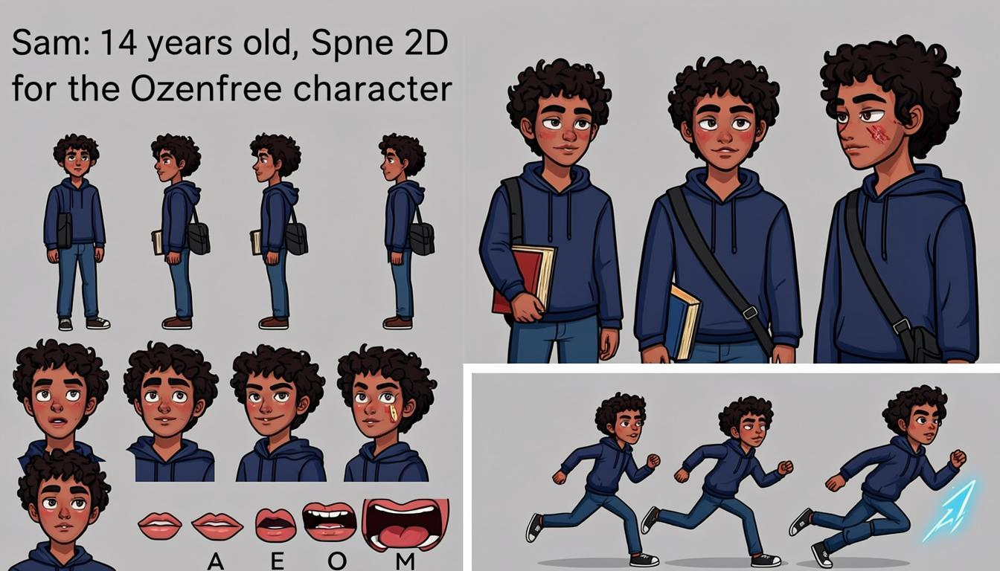

# Sam — Spine 2D Character Master Asset Sheet

Game-ready 2D character concept asset sheet for **Spine 2D / Live2D rigging**.
Character: **Sam**, a 14-year-old Iranian teenage boy.

## Art Style

- Oxenfree-inspired indie game aesthetic
- Painterly 2D vector look, soft ambient lighting
- Clean, readable high-contrast silhouettes
- Ultra-clean line art on a neutral gray background

## Character Design

- Distinct Iranian / Middle Eastern facial features
- Almond-shaped dark brown eyes, thick natural dark eyebrows
- Messy dark-brown curly hair, Persian olive skin tone
- Small adhesive bandage on the cheek
- Navy blue hoodie, dark casual jeans, sneakers
- Crossbody messenger bag with a Persian notebook peeking out
- Slim teenage proportions

## Files

| File | Content | Size |
|------|---------|------|
| `00_master_sheet_full.png` | Full three-part master sheet (turnaround + expressions + key poses) | 1344×768 |
| `01_turnaround_Apose.png` | Full-body A-pose turnaround — front / 3/4 / side / back, rig-ready | 1344×768 |
| `02_expression_grid.png` | Facial expression grid + lip-sync visemes (A / E / O / M) | 1024×1024 |
| `03_keyframe_poses.png` | Keyframe poses — idle / walk / run / jump / Word-Spear throw | 1344×768 |

## Layout — Three-Part Sheet

1. **Character Turnaround (top)** — four aligned full-body A-pose views
   (front, 3/4, side, back) with clearly separated limb joints
   (shoulders / elbows / knees) for 2D bone mapping.
2. **Facial Expression Grid (bottom-left)** — six headshots:
   neutral, focused (glowing eyes / slow-motion mode), surprised,
   action shout (casting mode), confident smile, and lip-sync visemes.
3. **Keyframe Poses (bottom-right)** — idle, walk, run, airborne jump,
   and the dynamic **Word Spear** throw.

## Rigging Notes (Spine 2D / Live2D)

- Slice the artwork into separate layers per body part before rigging
  (head, hair front/back, torso, upper/lower arms ×2, hands, hips,
  upper/lower legs ×2, feet, bag, notebook, hood).
- Keep the A-pose sheet as the mesh-placement reference.
- The expression grid maps directly to Spine *skins/attachments* or
  Live2D parameter blends (eyes, brows, mouth visemes A/E/O/M).
- Keyframe poses serve as timing references for idle / locomotion /
  jump / ability (Word Spear throw) animations.

> Generated with AI image generation as a concept-art base.
> Line-art cleanup and layer separation are still recommended before rigging.

---

## نسخهٔ فارسی

شیت اصلی asset های کاراکتر «سم» — پسر ۱۴ سالهٔ ایرانی — برای بایندینگ اسکلتی در **Spine 2D / Live2D**.

- **سبک هنری:** aesthetics بازی Oxenfree، وکتور نقاشی‌گونه، نور محیطی نرم، سیلوئت تمیز و خوانا
- **طراحی کاراکتر:** چشم‌های بادامی قهوه‌ای تیره، ابروهای پرپشت، موهای فرفری قهوه‌ای تیره، پوست زیتونی، چسب زخم روی گونه، هودی سرمه‌ای، شلوار جین، کتانی، کیف کراس‌بادی با دفترچه فارسی
- **فایل‌ها:**
  - `00_master_sheet_full.png` — شیت کامل سه‌بخشی
  - `01_turnaround_Apose.png` — ترن‌اراند A-pose چهار نمایه (ریگ‌آماده)
  - `02_expression_grid.png` — گرید حالات چهره و ویزیم‌های A/E/O/M
  - `03_keyframe_poses.png` — پوزهای کلیدی: idle / walk / run / jump / پرتاب Word Spear
- **نکتهٔ ریکینگ:** قبل از بایند، تصویر را به لایه‌های جداگانه (سر، مو، تنه، بازو/ساعد، لگن، ران/ساق، کفش، کیف، هود) برش دهید و خطوط را تمیز کنید.
