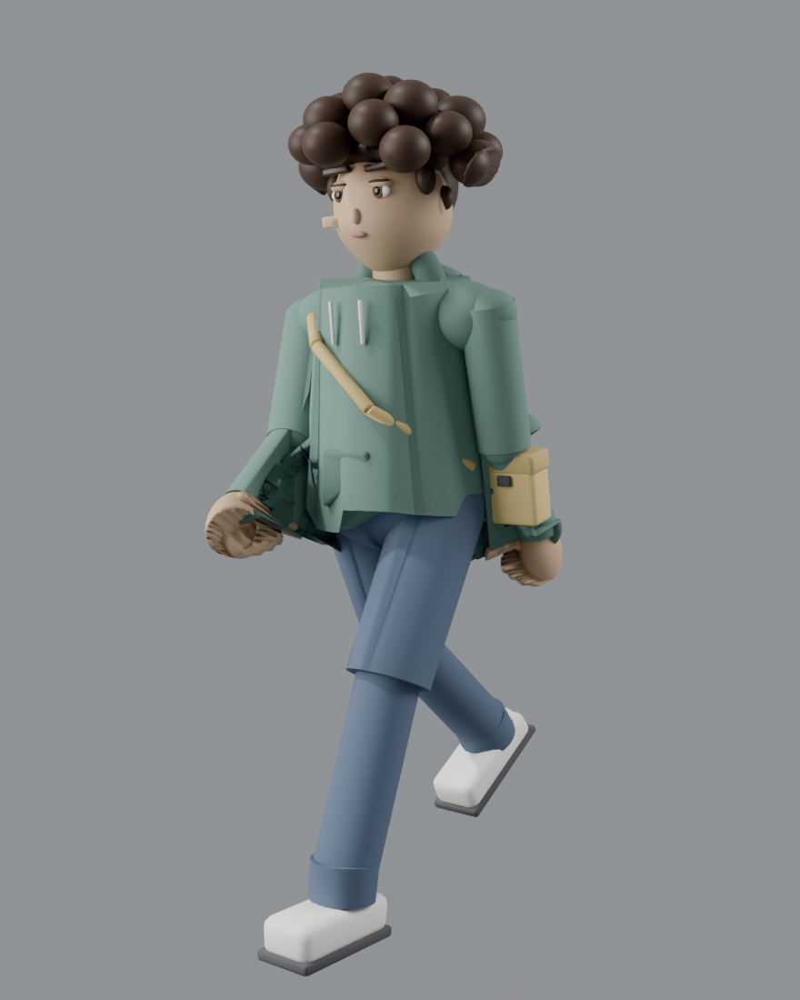

# Sam — Character Assets (2D Sheet + 3D Full-Body Rigged Model)

Game-ready character assets for **Sam**, a 14-year-old Iranian teenage boy:
a 2D master sheet for **Spine 2D / Live2D rigging** **plus a high-quality
full-body rigged 3D model with a walk cycle (FBX)**.

## Art Style

- Oxenfree-inspired indie game aesthetic
- Painterly 2D vector look, soft ambient lighting
- Clean, readable high-contrast silhouettes
- Ultra-clean line art on a neutral gray background

## Character Design

- Distinct Iranian / Middle Eastern facial features
- Almond-shaped dark brown eyes, thick natural dark eyebrows
- Messy dark-brown curly hair, Persian olive skin tone
- Small adhesive bandage on the cheek
- Muted-green hoodie, dark casual jeans, sneakers
- Crossbody messenger bag
- Slim teenage proportions

---

## 🚶 3D Full-Body Rigged Model + Walk Animation (NEW)

Folder: `sam-3d-character/` — supersedes the old low-poly head in `sam-3d/`.

| File | Content |
|------|---------|
| `sam_rigged_walk.fbx` | **Main deliverable** — model + rig + baked walk cycle (Unity / Unreal / Godot / Blender) |
| `sam_rigged_walk.glb` | GLB version (three.js / web viewers / Godot 4) |
| `sam_rigged_walk.blend` | Blender 4.3 source file (fully editable) |
| `sam_walk_cycle.mp4` | Walk-cycle preview video (2 loops, 24fps) |
| `preview_front.png` | Front render (contact pose) |
| `preview_side.png` | Side render (mid-stride) |
| `preview_head.png` | Face close-up render |

**Technical specs**

- Mesh: 155,318 verts / 152,948 faces — **high-poly**, smooth shaded
- Fixed, sculpted face (olive skin, curly dark hair, thick brows, almond eyes, band-aid)
- Rig: 22 bones — root / hips / spine / chest / neck / head + full limbs (.L/.R)
- Animation: `SamRigAction` — seamless walk cycle, frames 1–25, loops forever, baked into FBX
- Materials: 17 PBR materials (skin, hair, hoodie, jeans, sneakers, bag, band-aid…)
- Metric scale: ~1.47 m tall (~6 heads, Oxenfree-style proportions)
- Character faces **-Y** (Blender convention — rotate 180° in Unity)

**Import guide**

- **Unity**: drag the FBX into Assets → extract materials → drop the prefab in a scene → add `SamRigAction` to an Animator with *Loop Time* enabled.
- **Unreal**: Import FBX → enable *Skeletal Mesh* + *Import Animations*.
- **Godot 4**: drop the GLB (or FBX) into `res://`.
- **Blender**: `File → Import → FBX` — model, rig and animation all come in.

---

## 2D Master Asset Sheet (Spine / Live2D)

Folder: `sam-spine-asset-sheet/`

| File | Content | Size |
|------|---------|------|
| `00_master_sheet_full.png` | Full three-part master sheet (turnaround + expressions + key poses) | 1344×768 |
| `01_turnaround_Apose.png` | Full-body A-pose turnaround — front / 3/4 / side / back, rig-ready | 1344×768 |
| `02_expression_grid.png` | Facial expression grid + lip-sync visemes (A / E / O / M) | 1024×1024 |
| `03_keyframe_poses.png` | Keyframe poses — idle / walk / run / jump / Word-Spear throw | 1344×768 |

**Rigging notes**

- Slice the artwork into separate layers per body part before rigging
  (head, hair front/back, torso, upper/lower arms ×2, hands, hips,
  upper/lower legs ×2, feet, bag, notebook, hood).
- Keep the A-pose sheet as the mesh-placement reference.
- The expression grid maps directly to Spine *skins/attachments* or
  Live2D parameter blends (eyes, brows, mouth visemes A/E/O/M).
- Keyframe poses serve as timing references for idle / locomotion /
  jump / ability (Word Spear throw) animations.

---

## نسخهٔ فارسی

asset های کاراکتر «سم» — پسر ۱۴ سالهٔ ایرانی — شامل شیت دوبعدی برای **Spine 2D / Live2D** و **مدل سه‌بعدی فول‌بادی ریف‌شده با انیمیشن راه رفتن**.

- **سبک هنری:** aesthetics بازی Oxenfree، وکتور نقاشی‌گونه، نور محیطی نرم، سیلوئت تمیز
- **طراحی کاراکتر:** چشم‌های بادامی قهوه‌ای تیره، ابروهای پرپشت، موهای فرفری قهوه‌ای تیره، پوست زیتونی، چسب زخم روی گونه، هودی سبز، جین تیره، کتانی، کیف کراس‌بادی

**مدل سه‌بعدی جدید (پوشه `sam-3d-character/`) — جایگزین نسخه قبلی low-poly:**

- فایل اصلی: `sam_rigged_walk.fbx` — به‌همراه `glb` (وب/گودو) و `blend` (سورس کامل بلندر)
- **فول‌بادی و High-Poly:** حدود ۱۵۵ هزار ورتکس با سایه‌زنی نرم — لو پولی نیست!
- **چهره ثابت:** صورت مستقیماً روی مش ساخته شده — پوست زیتونی، موی فرفری تیره، ابروی پرپشت، چشم بادامی، چسب زخم گونه
- **ریف کامل:** ۲۲ استخوان (root/hips/spine/chest/neck/head + دو دست و دو پا)
- **انیمیشن راه رفتن:** چرخه بی‌نهایت (فریم ۱ تا ۲۵) به‌صورت baked داخل FBX + ویدیوی پیش‌نمایش `sam_walk_cycle.mp4`
- **مقیاس متریک:** قد حدود ۱٫۴۷ متر — رو به محور Y منفی (در یونیتی ۱۸۰ درجه بچرخانید)
- پوشه `sam-3d/` (سر low-poly قدیمی) فقط برای آرشیو نگه داشته شده

**نکتهٔ ریکینگ 2D:** قبل از بایند، تصویر را به لایه‌های جداگانه (سر، مو، تنه، بازو/ساعد، لگن، ران/ساق، کفش، کیف، هود) برش دهید و خطوط را تمیز کنید.
